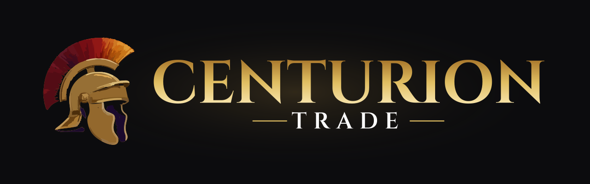
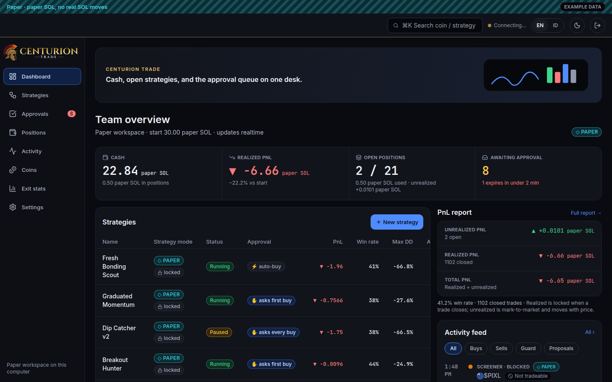
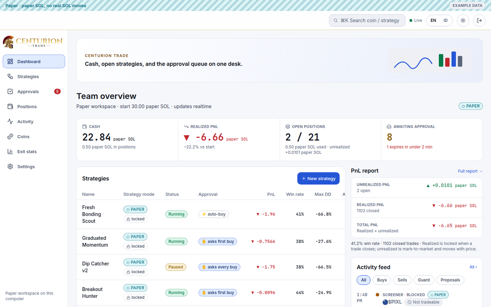

<p align="center">
  <picture>
    <source media="(prefers-color-scheme: light)" srcset="brand/readme-banner-light.svg">
    
  </picture>
</p>

<p align="center">
  <a href="https://github.com/gigabucks-hash/Centurion_bot/releases"></a>
  <a href="https://github.com/gigabucks-hash/Centurion_bot/actions/workflows/desktop.yml"></a>
</p>

<p align="center">
  A private Solana trading desk. Paper first.<br>
  Real stays off until you sign with your own wallet.
</p>

Centurion Trade is a paper-trading terminal for Solana tokens, with an opt-in Real mode. Two clients share one backend: the web app (`apps/web`) and the Windows desktop app (`apps/desktop`). The web app is also the phone surface. Mobile apps are cancelled. Nothing here is a hosted production deploy.

## What you can do

- Run the web app on a Windows laptop with one double-click. No Postgres and no rented server. See `docs/web-local-windows.md`.
- Trade on paper: approvals, positions, strategies, and the PnL report. Missing money stays a dash.
- Turn Real on only by signing with Phantom (web) or your own wallet (desktop). Starting limits are 0.05 SOL per trade, 0.5 SOL per day, a 2 SOL cap, and 3 positions. A tighter limit saves immediately. A looser limit needs another signature. The apps do not store a private key.
- The local web app records that signature and does not send a swap to the network.
- Use English or Bahasa Indonesia. With no saved choice, the theme follows the system.

<p align="center">
  
  
</p>

## Layout

| Path | What it is |
|---|---|
| `apps/web` | Next.js dashboard. Works in the browser and on a phone. |
| `apps/desktop` | Windows desktop app. Paper trading, and Real trading signed by your wallet. |
| `services/backend/api` | TypeScript REST and event stream. Practice mode. |
| `services/backend/crates` | Rust engine: ingest, screener, guard, paper simulation. |
| `services/backend/supabase` | SQL migrations. The schema is the source of truth for money. |
| `packages/contracts` | Shared wire contract and `errors.json` (`1.1.6`). |
| `packages/design-tokens` | Shared colour and type tokens (`0.3.4`). |
| `packages/i18n` | English and Indonesian copy (`0.4.12`). |
| `brand` | Official logo: wordmarks, helmet mark, Cinzel (OFL). |
| `docs/design` | Design notes, the logo reference, and the social preview. |
| `docs/release` | Desktop release notes and the local web guide. |

## Stack

- Node 22.18+ and TypeScript for the API, the web app, and the desktop UI.
- Rust 1.90 for the engine and the desktop shell.
- Postgres 17 locally, or Supabase for the SQL. The one-click Windows web launcher does not need Postgres.
- Icons in the product UI: Lucide. The brand mark is the approved helmet, redrawn as SVG.

## Run and test

```bash
# API (needs Postgres; refuses to start unless TRADING_MODE=paper)
cd services/backend/api && npm ci && npm run typecheck && npm test && npm start

# web (port 3100)
cd apps/web && npm ci && npm run dev
cd apps/web && npm run ci        # lint + typecheck + test + build + audit

# desktop
cd apps/desktop && npm ci && npm run dev
cd apps/desktop && npm run build && npm run test:ui
```

On Windows, double-click `Start-Centurion-Web.cmd` instead of the commands above. Stop it with `Stop-Centurion-Web.cmd`.

SQL: apply `services/backend/supabase/migrations` in order. The API tests need `psql` on `PATH`.

## CI

Three path-filtered workflows in `.github/workflows`.

| Workflow | Trigger paths | Extra on `main` push | Extra on `desktop-v*` tag |
|---|---|---|---|
| `backend` | `services/backend/**`, `packages/contracts/**` | — | — |
| `web` | `apps/web/**`, `packages/*` | — | — |
| `desktop` | `apps/desktop/**`, `packages/*` | Linux packages, Windows installers | Signed Windows release and `latest.json` for the updater |

## Pins

- Money is integer lamports end to end. Clients do not re-sum server totals.
- `packages/design-tokens` stays at **0.3.4**.
- `packages/contracts` stays at **1.1.6**. The desktop app pins it in `contracts.pin.json`.
- No secret in the repo. CI reads repository secrets only.
- Real is off until a wallet signature. Do not deploy a public host from this tree.

## Desktop updates

The installed Windows app checks the latest published GitHub release for `latest.json`, verifies the signed installer, installs it, and restarts (`Settings → Update aplikasi`).

1. Bump the desktop version in its config, `Cargo.toml`, and `package.json`. The exact files are listed in `docs/release/desktop.md`.
2. Push a tag `desktop-vX.Y.Z` (or run the `desktop` workflow with that tag).
3. CI signs the Windows bundles, publishes the release, and refreshes `latest.json`.

See `docs/release/desktop.md`.

## Docs

- `docs/web-local-windows.md` — one-click web app on a Windows laptop.
- `docs/design/ASSETS.md` — logo, font, and icon licenses.
- `docs/design/pnl-report.md` — PnL card and report.
- `docs/release/desktop.md` — installers, versioning, updater, signing.
- `docs/release/web-local.md` — optional Postgres paper stack.
- `services/backend/docs` — engine and API design.

The wide image for GitHub’s social preview setting is `docs/design/social-preview.png` (1280×640). GitHub does not read that file on its own. Set it under the repository Settings → Social preview.
