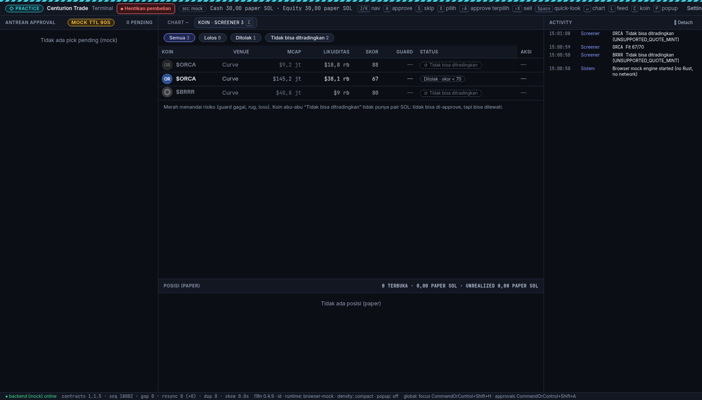

# Centurion Trade — Desktop (apps/desktop)

> Visible product name **Centurion Trade** (Boss decision 2026-10-29; from `@centurion/i18n` `app.name`), identifier
> `com.centuriontrade.app`. Internal crate / package / repo names stay `centurion` (`centurion_lib`, `@centurion/*`).

Tauri v2 + React 19 trading terminal prototype. **Mock data only**: no wallet, no chain network, no real trading.
See `ARCHITECTURE.md` and `MILESTONES.md`. Types come from `../../packages/contracts`.

## Prerequisites (Linux)
- Rust stable (rustup) and Node 20+.
- System libraries: `libwebkit2gtk-4.1-dev libgtk-3-dev libayatana-appindicator3-dev librsvg2-dev libxdo-dev libssl-dev`.
- Tauri CLI: `cargo install tauri-cli --version ^2`.

## Commands
```bash
cd /workspace/centurion/apps/desktop
npm install
npm run dev                 # browser-only UI with the built-in mock adapter (http://localhost:1420)
cargo tauri dev             # full desktop app
npm run build               # typecheck + Vite build
(cd src-tauri && cargo check && cargo test)
cargo tauri build --bundles deb   # unsigned Linux release (MVP) → src-tauri/target/release/bundle/deb/Centurion Trade_0.1.0_amd64.deb
npm run sync:tokens         # pull tokens from packages/design-tokens (falls back to the embedded copy)
```

## Keys
| Key | Action |
|---|---|
| J/K or ↑/↓ | Move through the queue |
| A | Approve |
| S | Skip |
| X | Select |
| ⇧A | Approve selected (Practice only) |
| ⇧X | Sell: opens the dialog, then hold the confirm button with the mouse, Space or ↵ (1.2 s Practice / 2.5 s Real) |
| Space | Quick-look for the **focused row** (J/K focuses rows; row click also opens it). On buttons/checkboxes Space works natively |
| ↵ | Pop out the chart (only from a focused row, no dialog open) |
| C | Toggle the centre tab Chart ↔ **Koin · screener** (WF-20 screener rows incl. not-tradeable) |
| L | Activity window |
| P | Approval popup (Linux only for now; disabled on Windows/macOS until W-NOFOCUS passes; 360×232, bottom-right; PRACTICE: Approve/Skip; REAL: Skip + "Buka untuk approve ↗") |
| , | Settings |
| Esc | Close |

Global shortcuts: Ctrl/Cmd+Shift+H focuses the terminal; Ctrl/Cmd+Shift+A opens approvals. They never trade.

## Preview REAL SOL chrome (Phase 7 reference, still mock)
```bash
CENTURION_MOCK_MODE=real cargo tauri dev   # desktop
# browser: http://localhost:1420/?mode=real
```
In REAL mode the popup cannot approve. Approve from main needs the dialog + a 2.5 s hold. No wallet and no network in either mode.

Screenshots: `docs/` (screenshot-v11-terminal, screenshot-v11-conflict, screenshot-v11-after-sell, popup-practice, popup-real, real-handoff-confirm, positions-compact-sell, wf20-screener-tab, wf20-coin-detail, wf20-queue-card-not-tradeable, wf20-positions-sell-unavailable, wf20-sell-shortcut-blocked, wf20-quicklook-not-tradeable, …).

## What is mocked
- The whole backend, as an in-process mock server that speaks the contracts v1.1.4 wire. It is the default; `CENTURION_BACKEND=http://127.0.0.1:…` switches to the real HTTP+SSE transport (see "Real backend" below and `docs/REAL_TRANSPORT_SMOKE.md`). It covers the token stream, prices, guard and screener results, the exit plan, the paper book (30 SOL, 0.25 SOL per trade, 125 bps fee), strategies with rev, practice reset, coin timeline and exit-reason stats.
- It lives in `src-tauri/src/backend/mock.rs`. The desktop reaches it only through the `Transport` trait.

## Mock environment variables
| Var | Default | Effect |
|---|---|---|
| `CENTURION_MOCK_SKEW_MS` | `2500` | Offsets the mock server clock from the local clock, to show the skew correction (C6) |
| `CENTURION_MOCK_FORCE_CONFLICT` | off | `1` makes the mock "edit on mobile" before every strategy write, so each pause/resume returns a 409 conflict toast |
| `CENTURION_MOCK_MODE` | `practice` | `real` previews the Phase 7 Real chrome (still mock, no wallet) |
| `CENTURION_MOCK_NOT_TRADEABLE` | `screener` | WF-20 not-tradeable state. `screener`: ~15% of new coins are USDC/USDT-quoted, so they show only as screener rows (guard not run, never proposed). `race`: also flips ~40% of SOL coins to a non-SOL quote ~8 s after they are proposed (queue card goes disabled) and ~40% of opened positions (Sell disabled; a sell that still reaches the mock gets `422` + `order.failed UNSUPPORTED_QUOTE_MINT`). `off`: every coin is SOL-quoted |

Browser preview (`npm run dev`, no Tauri): `?nt=screener|race|off` mirrors `CENTURION_MOCK_NOT_TRADEABLE`, `?tab=coins` opens the screener tab, `?mode=real` previews Real.

### Not tradeable (WF-20)
Not tradeable is a product limit, not a danger, so the chip is neutral (⊘, dashed, `text.tertiary` on `bg.inset`) and never red. The row is dimmed, the Aksi column is empty, and the detail panel explains why (`ⓘ`, Pair quote `USDC · bukan SOL`, Pair SOL `tidak ada`, Skor `… (informasi saja)`, Guard `tidak dijalankan`, Reason code). The chart stays live but greyed and read-only, and there is a disabled `Approve — tidak tersedia` with the reason written out (not tooltip-only). It is blocked three times:
1. UI: buttons are disabled, and A / ⇧A / ⇧X refuse with a text reason in the status bar.
2. Rust commands: `approve_signal`, `approve_many`, `request_sell` and `confirm_sell` (re-checked at confirm, so a quote taken before a flip is refused) return `UNSUPPORTED_QUOTE_MINT: …`.
3. Mock server: `422` + `order.failed`.

Skip stays allowed on a not-tradeable card (rejecting is not a trade; UX Rev 4.4), with `queue.skip_reason.not_tradeable` preselected. Contracts 1.1.3 sends it on the wire: a skip carries `reject_reason: "not_tradeable"` for a not-tradeable card and `"user_declined"` for a normal one (`commands.rs skip_reason`). `reject_reason` is only sent with `decision=reject`; the mock refuses it on approve, and refuses unknown values, with `422 VALIDATION_FAILED`, like the server. The card is left out of batch approve (checkbox disabled; `queue.batch.excluded_not_tradeable`). Its timer, countdown and status are neutral, never red, and so is the status-bar reason. The coin detail offers Lewati + `screener.detail.skip_hint` when the coin has a pending pick. The screener Mcap column shows contracts 1.1.4 `mcap_usd` (display-only); the tooltip shows `market_cap_lamports` as SOL and `mcap_as_of`, and a null value shows "—".

### Practice cash: two different codes
- `order.failed` `INSUFFICIENT_PRACTICE_BALANCE` (kind error): one order failed, shown as a red feed line.
- `system.notice` `PRACTICE_CASH_INSUFFICIENT` (kind notice): strategy entries are paused, shown as a neutral, persistent "entries paused" strip. It clears when an entry fills again or Practice is reset.

### Language
UI text comes from `@centurion/i18n` 0.4.11 (`packages/i18n`, read-only; ICU messages via `src/i18n/icu.ts`, numbers via its `format.mjs`). Settings → Bahasa switches `id` (default) and `en`. Error text: code → key via the package `errors.map.json` (v7, 67 codes incl. `GUARD_WEAKEN_REQUIRES_APPROVAL`, quote-stale and per-strategy `MODE_NOT_ALLOWED`), catalog copy in the UI locale, falling back to `errors.json` `messages.id/en` (codes newer than the map, e.g. errors v6 `QUOTE_MISSING_OR_STALE`, use that fallback); unknown code → `error.code.internal`. Placeholders are wire field names (`{symbol}`, `{amount_lamports}` formatted with `formatLamports`). All former `desktop.*` strings are package keys since 0.4.4 (`key-migrations.json`); `src/i18n/local.ts` keeps the "(mock)" dev suffix plus two fallback templates (`feed.event.fill`, `feed.event.exit_triggered`) used only until UX ships those keys. Skip chips and `reject_reason` copy come from `reject_reasons.map.json` (Rust `rejmap.rs`, TS `skipChip()`). `npm run test:ui` runs `scripts/ui-format.test.mjs` (node --test).

Real backend (dev): `CENTURION_BACKEND=http://127.0.0.1:<port>` + `CENTURION_WORKSPACE_ID` + `CENTURION_BACKEND_TOKEN` switches to the REST/SSE `HttpTransport` (default: mock; plain http only to loopback). `scripts/smoke-real.sh` runs the real-transport smoke test against `services/backend/api` (35 cases; results and contract mismatches in `docs/REAL_TRANSPORT_SMOKE.md`). `--serve` keeps the API up for the app. The dev JWT secret lives in the gitignored `.env.local`.

Contracts: `packages/contracts` **v1.1.6** at `ca52707`, pinned in `contracts.pin.json` (read-only; tests read the committed HEAD version and fail on drift). `cargo test` includes contract tests against those files (errors.json v4+, typed 1.1.2 examples, 1.1.3 `ApprovalRejectReason` / `ApprovalWire`, 1.1.4 `MarketCapFields` / `stall`), and `npm run build` typechecks `src/api/wire.check.ts`. The wire constant `CONTRACTS_VERSION = "1.1.6"` in `packages/contracts/src/wire/events.ts` matches the package, and the status bar shows 1.1.6. Design tokens: `packages/design-tokens` **v0.3.4**; `npm run sync:tokens` copies the approved 23-token subset (`--color-bg-chrome`, `--color-scrim-sheet`, `--shadow-card`, `--shadow-dialog`, `--color-semantic-onWarning`, coin-logo/identicon tokens) into `src/design/centurion-tokens-subset.css` and keeps the pre-G1-blue main copy until `--full` is requested.

Practice reset is limited to once per 24 h. A second reset gets `429 RESET_COOLDOWN` with `{next_allowed_at}` and `Retry-After` (the in-process mock carries `retry_after_s`). Settings shows it as neutral text, not an error ("Berikutnya: <local date, time>"), and disables the button until then (`docs/practice-reset-cooldown.png`).

## Stop (quick actions)
- In-app: **■ Stop sekarang** in the title bar → confirm dialog → pauses every running strategy in the current mode.
- Tray menu: **Stop trading…** (tooltip = `app.name`).
- Linux app-shortcut action (right-click the launcher): **Stop trading** = `centurion --stop` (binary keeps the internal name; package `centurion-trade`).
  A running instance receives it through single-instance argv.
- Every path only opens the confirm dialog. Pausing happens in one Rust command, `stop_trading(mode, source, confirm="STOP")`.
- Windows jump list / macOS dock menu: not buildable here (see ARCHITECTURE §12 D17). Both would run the same `--stop` argv.

## Wallet login (SIWS) — backend mode only
`CENTURION_BACKEND=<url>` without `CENTURION_BACKEND_TOKEN` → wallet login through the **system browser** (`CENTURION_LOGIN_URL`,
default `https://app.centuriontrade.local/auth/desktop`). Tokens live only in the OS keychain (`com.centuriontrade.app` / `siws-session`).
Manual round-trip test (needs the Web `/auth/desktop` page + Phantom; not headless): see ARCHITECTURE §12 D15.

## Coin logos (CoinAvatar, COIN_LOGO Rev 6.0)

`src/components/CoinAvatar.tsx` shows a coin logo at 32 px (queue card, Quick-look header) or 24 px (screener and positions rows).

- **Source:** the image comes only from the backend logo proxy `GET /v1/img/coin/{mint}?s=48|64|96&v={logo_hash}`.
  - Rust (`src-tauri/src/logo.rs`) accepts a wire `logo_url` only when it has the exact backend origin, the path `/v1/img/coin/{same mint}`, and only `s`/`v`/`fmt` params.
  - Only the validated hash reaches the webview, which rebuilds the URL from `snapshot.logo_origin`.
  - The client asks for at most s=96 until the proxy serves 128/192.
- **Fallback:** a deterministic identicon from the mint (`identicon.ts`: FNV-1a 32 → 12-colour palette, 1–2 initials from the symbol), used when there is no hash, on any image error, or when logos are off.
  - Session cache: LRU of 200; a failure is final per mint+hash; a timeout (4 s) gets one retry.
  - The skeleton appears after 150 ms and stays at least 300 ms.
- **Not tradeable:** grayscale, opacity 0.55, dashed ring.
- **CSP:** the committed `img-src` stays `'self' data:`.
  - For a backend build, run `npm run tauri:build:backend` (or `tauri:dev:backend`). It runs `scripts/csp-logo-origin.mjs`, which validates `CENTURION_BACKEND` and writes the gitignored `src-tauri/tauri.logo-csp.json`, adding exactly that one origin.
  - If the compiled CSP does not list the backend origin, Rust turns logos off (identicons only).
- **Mock:** origin `https://logo.mock.invalid`, served from the bundled `public/mock-logo/*.webp`.
  - About 70% of mints get a logo, 10% a missing one (→ identicon), and 20% none.



## Stop control: i18n 0.4.9 keys

- `kill_switch.action.open` → `kill_switch.dialog.title` for the Real button title (`kill_switch.action.engage` is the action label).
- `kill_switch.dialog.effect.buys` → `kill_switch.dialog.effect.exits_keep`.
- `scripts/ui-format.test.mjs` fails if any literal `t("…")` key in `src/` is deprecated or removed in `key-migrations.json`, or is missing from the catalog.
