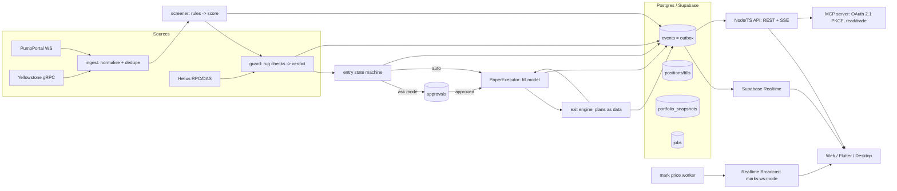

# Sentra backend: technical design (Phase 1 in detail, then Phases 2 and 4)

Owner: Backend API Specialist. Status: draft v1, 2026-10-29. Contracts: `packages/contracts/*`.
**Hard rules:** paper trading only. No private keys anywhere. Only `PaperExecutor` ships; `LiveExecutor`
is a stub behind the `live-execution` cargo feature (off) and returns `LiveDisabled`. The service refuses
to start unless `TRADING_MODE=paper`, and the DB rejects `mode='real'`. All code is original; the HotBot
MCP was used only to understand the feature set.

## 1. Architecture

Processes: (1) the **Rust worker** (`services/backend/crates/*`) handles ingest, screening, guard, entry,
paper execution, exits, the sweeper and snapshots. (2) The **Node/TS API** (Phase 2) serves REST, SSE and
MCP, does auth glue and mints tokens. (3) **Supabase**: Postgres, RLS, Auth, Realtime and Edge Functions
(SIWS, Telegram, OTP).

## 2. Data flow (per coin)
1. Source event -> `CoinCandidate` (mint, stream, pool, creator, untrusted metadata). Dedupe on
   `(mint, stream)`. Emit `coin.detected`.
2. Screener: rules from strategy settings (JSON, validated by schema + DB CHECK). Stream rules gate,
   hard rules must pass, weighted rules add points against `pass_mark`. Emit `screener.scored`.
3. Guard: input snapshot (authorities, LP, holder concentration, dev/bundler/sniper %, transfer fee, sell
   simulation, creator history). Saved to `guard_input_snapshots` for replay. Emit `guard.result`.
4. Pick + entry state machine (section 3). Then the approval gate (section 6), then the executor.
5. PaperExecutor: constant-product fill on a pool snapshot with latency drift, competing flow, the
   125 bps swap fee and network/priority fees. Emit `fill.simulated` and `position.opened`.
6. Exit engine on marks (section 4), then `exit.triggered`, a sell fill, then `position.updated|closed`,
   then `portfolio.snapshot`.

## 3. Entry state machine
`detected -> screened -> guarded -> armed -> (awaiting_approval) -> filling -> open` with terminal
`rejected | expired | failed`.
- `armed`: optional entry condition (dip %, momentum, max wait). Timeout emits `entry.expired`.
- `awaiting_approval` when `approvalMode = ask_every_buy`, or `ask_first_buy` and the portfolio has no
  prior buy (the default). The proposal TTL is 10 min. While waiting the guard and price are re-checked;
  failures expire the proposal with `guard_failed|price_moved`.
- `filling`: a job row (`jobs`, `FOR UPDATE SKIP LOCKED`) runs the PaperExecutor idempotently, keyed by
  `ck`.
- Rebuy rules: cooldown per mint, max entries per coin, and a per-strategy concurrency cap.

## 4. Exit engine (plans are data)
A plan is an ordered list of rules in strategy settings, evaluated on every mark tick and on a 1 s timer.
**`sellFloors` is evaluated first** (`{enabled, maxLossPct: 35, liquidityDropPct: 80}`): PnL <= -35% or
pool liquidity down >= 80% from entry triggers a 100% sell (`exit_reason = sell_floor`). Then, in
declared order: take-profit ladders, trailing stop with activation, step lock, stop-loss, time-out,
inactivity/stall, drain/rug detection. Each rule is `{kind, params, sell_pct}`. State (peaks, executed
steps) lives in `positions.plan_state` jsonb, so restarts resume exactly. A strategy archive/delete
closes positions with `strategy_retired` only if the setting says so; otherwise they keep running
under the frozen plan.

## 5. Job queue, events feed, outbox
- `jobs`: `(id, kind, key unique, run_at, attempts, locked_until, payload)`. Workers `SELECT ... FOR
  UPDATE SKIP LOCKED`, with exponential backoff, at most 8 attempts, then a `system.notice` dead letter.
- `events` **is the outbox**: domain writes and their events commit in one transaction. `seq` is a
  global identity (monotonic, gaps possible). Publishers (SSE, webhooks) read up to
  `events_safe_seq()` (derived from `pg_snapshot_xmin` + `xid8`) and advance `outbox_cursors`.
  Side-channel deliveries (push/email/webhook) go in `outbox` rows created in the same transaction.
- Deterministic event ids (`<subject>:<ms>:<type>`) plus a unique constraint make writes idempotent.

## 6. Approval queue
- Kinds `buy_pick` (TTL 10 min), `guard_change` (24 h), `team_action` (1 h); configurable in
  `workspaces` settings and env.
- Status `pending -> approved|rejected|expired`, `approved -> expired` (if not executed in time).
  `approvals_guard` trigger **only rejects illegal transitions**; the worker drives them.
- Decide: `decide_approval()` (security definer) checks the token (sha256, single use, TTL <=
  expires_at), then the MCP/app rule, role, replay (same token or same Idempotency-Key with the same
  decision), key reuse, already decided, expired, `expected_rev` vs `version`, and `base_rev` vs
  strategy `rev`. It then applies the decision, emits `proposal.approved|rejected`, writes `audit_log`
  and burns the token.
- Expire: the sweeper runs `expire_due_proposals()` every 2 s. `retire_strategy(id, archive|delete)` locks
  the strategy and expires everything pending in the same transaction (`proposal.expired {proposal_id,
  kind, version, reason, at}`), plus the strategy event and audit row.

## 7. Guard change and replay; the < 2 s answer
- A settings PATCH is diffed per field against the "weakening" direction table (e.g. raising
  `maxTop10Pct`, lowering `minLiquidityUsd`, disabling a check).
- **Static estimate** (`guard::static_estimate`, ships first): uses the stored per-rule `blocked_by`
  counts over the window to bound the extra passes and classify risk low/medium/high/critical. O(rules),
  under 1 ms in-process.
- **Full replay** (`guard::impact`, behind `GUARD_REPLAY_ENABLED`): re-runs the old and new configs
  over `guard_input_snapshots` joined with `coin_outcomes` in a 7-day window capped at 50k samples.
  Returns `ImpactReport` (newly passing and blocked, newly passing rugged, average drawdown).
- **Measured on 2026-10-29 (box, release build):** 50,000 samples x 2 configs = **172.5 / 175.8 / 180.1
  ms**. A cold Postgres fetch of 50k snapshot rows (jsonb) took **121–133 ms**; JSON decode in Rust is
  estimated at 100–200 ms.
- **Verdict: yes, the replay can respond in under 2 s.** Expected p50 is about 0.2 s with a warm
  in-memory window and about 0.5 s cold; p95 is under 1 s. It ships only after staging p95 under 2 s is
  observed. Over budget, it returns `503 REPLAY_UNAVAILABLE` and the UI uses the estimate.
- **Real SOL weakening** (designed, disabled): a mandatory 10 min cooldown (`cooling_down`, cancellable),
  then apply, then a mandatory 24 h auto-revert job. Enforced by a CHECK on `guard_changes`. Requires
  proof-of-confirmation (WebAuthn, typed name, 2.5 s hold, TOTP), notifies every device plus email, and
  appends to `audit_log` with a risk snapshot. `LIVE_GUARD_WEAKENING_ENABLED=false`.

## 8. API (Node/TS) and MCP
- REST and SSE as in `packages/contracts/API_ENDPOINTS.md`. Every response carries `server_now`; the
  `Idempotency-Key` store is `api_idempotency`; the error enum is shared.
- MCP: Streamable HTTP. OAuth 2.1 authorization code with **PKCE S256**, dynamic client registration,
  protected-resource metadata, audience-bound tokens. Scopes `read` and `trade`; `trade:real` never.
  MCP tools: list strategies/positions/events, propose a settings change, approve a `buy_pick` in
  practice. Guard weakening and team actions are **app-only** (`APPROVAL_REQUIRES_APP`). Token metadata
  is passed to the LLM only inside an `untrusted` field.

## 9. Auth
Supabase Auth: Google and Apple (native PKCE), email OTP (6 digits, HMAC-hashed, 10 min, 5 attempts,
then a 15 min lock, 60 s resend), Telegram (Login Widget HMAC, Edge Function), and SIWS (nonce 5 min,
single use, bound to domain and address; ed25519). Identities link to one user in `auth_identities`; the
last one cannot be removed. Login wallets are identity only and never trade.

## 10. Security model
- No private keys. `wallets` is a custody **reference** (public address, label), with no secret columns.
- Defence in depth for paper-only: the env gate (`TRADING_MODE=paper`, required explicitly), a cargo
  feature that is off by default, a `LiveExecutor` that returns an error, DB CHECKs on every `mode`
  column, a `trade:real` scope that is never minted, and CI checks that the feature is off.
- RLS on every table: workspace membership plus the mode gate. Service role is used only by the worker
  and API. Security definer functions use `set search_path`, and EXECUTE is revoked from public.
- Untrusted token metadata is isolated, length-capped and rendered as plain text.
- Secrets only in env vars (`.env.example` holds no values); gitleaks runs in CI.
- Append-only `audit_log`; proof hashes; rate limits on auth and decision endpoints.

## 11. Observability
`tracing` JSON logs with `request_id`, `ck`, `workspace_id`. Metrics (OpenTelemetry/Prometheus):
ingest lag, events/s, screener pass rate, guard verdict mix, fill latency, queue depth, sweeper lag,
outbox lag (`max(seq) - cursor`), replay `compute_ms` p50/p95, and 409 rates by code. Health
`/healthz` and `/readyz` (DB, sources, `trading_mode`). Alerts: outbox lag over 10 s, sweeper lag over
10 s, ingest silence over 60 s.

## 12. Testing
- Unit: screener rules, guard checks, the fill formula (fees, slippage, latency), approval decide/expire
  precedence, portfolio maths, static estimate, units/no-floats.
- Contract: errors.json parity (Rust and TS), TS typecheck, an end-to-end pipeline test asserting there
  are no floats on the wire, `mode=practice`, and integer seq.
- SQL: `scripts/check_sql.sh` covers the migration plus smoke tests (RLS isolation, mode gate, tokens,
  decide replay/conflict, retire, settings CHECK, confirmation challenge).
- Performance: an ignored release test, `replay_budget_50k_samples`, which CI runs.
- Later: property tests on exits, and replay fixtures from recorded streams.

## 13. Phase 1 plan (week by week)
| Week | Deliverable |
|---|---|
| 1 | Contracts v1 frozen. Workspace skeleton, migration 0001 with RLS, CI. *(done)* |
| 2 | Real PumpPortal + Yellowstone clients behind the traits; dedupe; replay source; metrics. |
| 3 | Screener and guard on live data; `guard_input_snapshots`/`coin_outcomes` writer; static estimate. |
| 4 | Entry state machine, jobs, PaperExecutor wired; positions/fills; portfolio snapshots. |
| 5 | Exit engine with sell floors; sweeper; `retire_strategy`; events SSE in the minimal API. |
| 6 | Soak test (72 h practice), dashboards, bug-bash, Phase 2 hand-off (approvals API, MCP). |
Phase 2: Node API (REST/SSE/approvals/auth Edge Functions) and the replay endpoint behind its flag.
Phase 4: MCP with OAuth 2.1, push worker, device tokens.

## 14. Risks
Data source rate limits or outages (mitigation: two sources plus replay). Fill-model optimism
(calibrate against observed swaps). Realtime fan-out cost (filtered subscriptions, Broadcast throttling).
Settings key names mirroring HotBot's vocabulary (rename before freeze). Replay window growth (cap and
sample).

## 15. Open questions (for Apex)
1. Rename settings keys and exit-plan ids that mirror HotBot's reference names before the v1 freeze?
2. Settings thresholds are still JSON numbers (ratios are fractional). Switch them to decimal strings for
   consistency?
3. `weakened_fields` uses camelCase setting names while everything else is snake_case. Is that OK,
   since they are setting keys?
4. Who owns the Dart error-code generator (Backend or Flutter)?
5. Practice starting balance and reset policy (default 30 SOL)?
